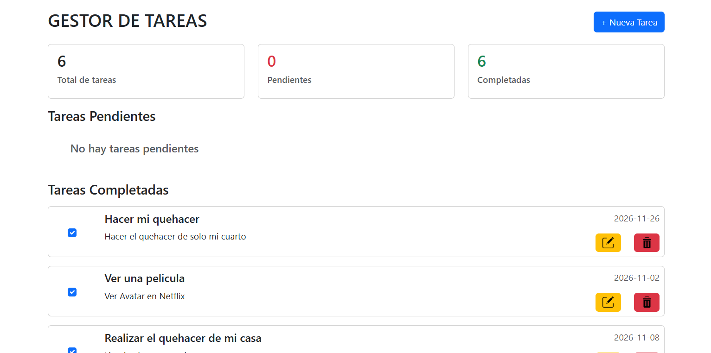
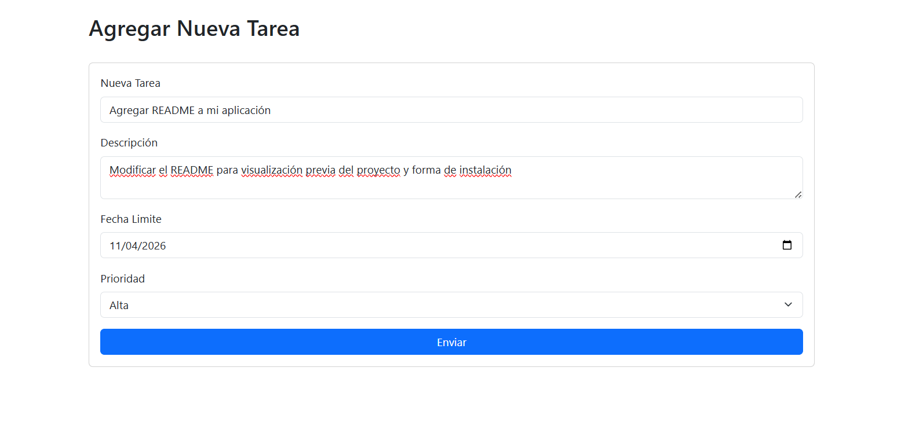
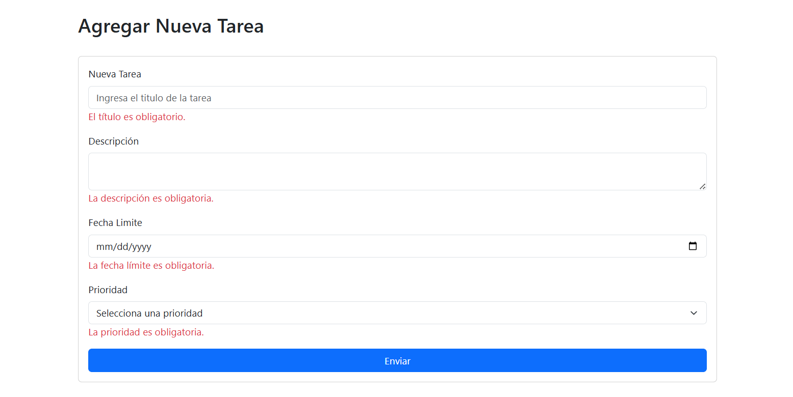
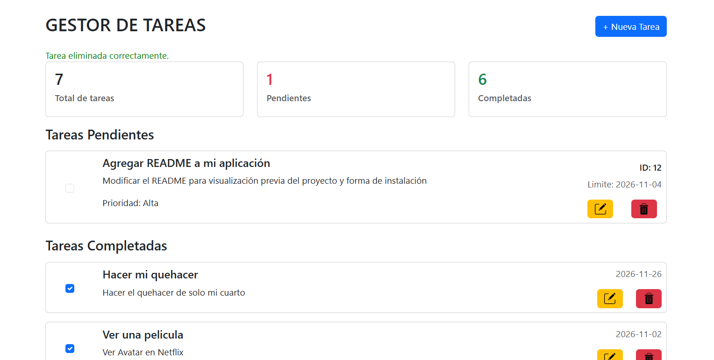
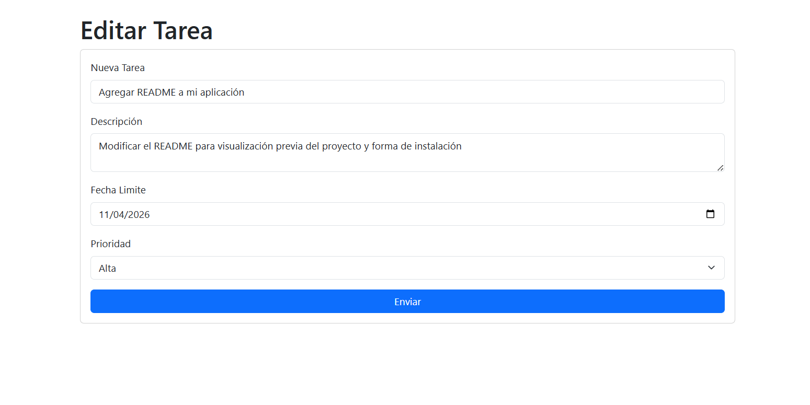

# Gestor de Tareas

Aplicación web desarrollada con Laravel que permite administrar tareas personales mediante un sistema de registro, consulta, edición y eliminación. Su objetivo es facilitar la organización de actividades, permitiendo establecer prioridades, fechas límite y controlar el estado de cada tarea.

## Tecnologías utilizadas

- **PHP:** Lenguaje de programación del backend.
- **Laravel 13:** Framework utilizado para el desarrollo de la aplicación.
- **MySQL:** Sistema de gestión de bases de datos.
- **Bootstrap:** Framework CSS para el diseño y la interfaz responsiva.
- **JavaScript:** Implementación de funcionalidades interactivas.
- **Blade:** Motor de plantillas de Laravel.
- **HTML5 y CSS3:** Estructura y estilos de la aplicación.

## Funcionalidades

- **Registro de tareas:** Permite agregar nuevas tareas con título, descripción, fecha límite y prioridad.
- **Consulta de tareas:** Visualización de las tareas registradas.
- **Edición de tareas:** Permite modificar la información de las tareas existentes.
- **Eliminación de tareas:** Permite eliminar registros mediante una acción de confirmación.
- **Control de tareas completadas:** Permite cambiar el estado de una tarea mediante un checkbox, actualizando la información sin recargar la página.
- **Administración de prioridades:** Clasificación de tareas en prioridad baja, media y alta.
- **Validación de datos:** Verificación de la información antes de almacenarla o actualizarla.

## Instalación y configuración

Para ejecutar este proyecto localmente, es necesario contar con PHP, Composer, Node.js, MySQL y un entorno de desarrollo como Laragon.

### 1. Clonar el repositorio

```bash
git clone URL_DEL_REPOSITORIO
```

Ingresar a la carpeta del proyecto:

```bash
cd NOMBRE_DEL_PROYECTO
```

### 2. Instalar dependencias

Instalar las dependencias de PHP:

```bash
composer install
```

Instalar las dependencias de JavaScript:

```bash
npm install
```

### 3. Configurar el archivo .env

Crear el archivo de configuración a partir del ejemplo:

```bash
cp .env.example .env
```

Generar la clave de la aplicación:

```bash
php artisan key:generate
```

Configurar las credenciales de la base de datos en el archivo `.env`:

```env
DB_CONNECTION=mysql
DB_HOST=127.0.0.1
DB_PORT=3306
DB_DATABASE=gestor_tareas
DB_USERNAME=root
DB_PASSWORD=
```

Crear previamente la base de datos `gestor_tareas` en MySQL.

### 4. Ejecutar las migraciones

Crear las tablas necesarias:

```bash
php artisan migrate
```

### 5. Compilar los recursos del frontend

```bash
npm run build
```

### 6. Iniciar el servidor

```bash
php artisan serve
```

Abrir la siguiente dirección en el navegador:

```text
http://127.0.0.1:8000
```

## Estructura general del proyecto

```text
gestor-de-tareas/
│
├── app/
│   ├── Http/
│   │   ├── Controllers/
│   │   └── Requests/
│   └── Models/
│
├── database/
│   └── migrations/
│
├── public/
│   ├── images/
│   └── build/
│
├── resources/
│   ├── views/
│   ├── css/
│   └── js/
│
├── routes/
│   └── web.php
│
├── storage/
├── .env.example
└── README.md
```

## Objetivo de aprendizaje

Este proyecto fue desarrollado como parte de mi proceso de aprendizaje de Laravel, con el propósito de fortalecer mis conocimientos en desarrollo backend, administración de bases de datos y construcción de aplicaciones web.

Durante su desarrollo se practicaron conceptos como el patrón MVC, operaciones CRUD, migraciones, modelos Eloquent, validación mediante Form Requests, manejo de solicitudes HTTP, rutas y actualización de información mediante JavaScript Fetch API.

## Capturas de pantalla

### Página principal



### Registro de tareas



### Registro de tarea con error



### Tarea Agregada




### Edición de tareas



## Autora

Desarrollado por **Brenda Salazar Mendiola**.

Proyecto realizado con fines educativos y de práctica profesional en desarrollo de software.